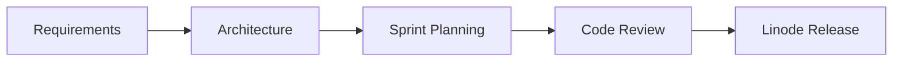

# ⚡ Revanth Kumar Vanjarapu
### Senior Full Stack Developer & Team Lead

 

🚀 Lead Full Stack Engineer  |  ⚡ Real-Time Dispatch & WebSockets  |  🗺️ Maps & Geolocation  |  📱 React Native & Next.js

---

---

## 🧭 Executive Overview

Senior Full Stack Engineer and Engineering Lead with nearly 5 years of experience delivering high-concurrency web and mobile platforms across logistics, ride-hailing, and EdTech. 

* **Team Leadership:** Currently leading a team of 8 engineers at VSAAS Technologies, driving sprint delivery, code reviews, and architecture decisions.
* **Core Specialty:** Real-time dispatch engines (Redis & WebSockets), live geospatial tracking (Google Maps SDK, TomTom, Leaflet, OSRM)[cite: 1], and cross-platform mobile apps (React Native, Capacitor)[cite: 1].
* **Delivery Track Record:** Shipped zero-to-production systems in accelerated 3-to-5 week development cycles[cite: 1].

---

## 🛠️ Technology Stack & Tooling

| Domain | Technologies & Frameworks |
| :--- | :--- |
| **Frontend & UI** |      |
| **Backend & Real-Time** |     |
| **Mobile** |   |
| **Database & Cache** |    |
| **Mapping & Geolocation** |    |
| **Infrastructure & DevOps** |     |

---

## 🏗️ Production Architecture & Deliverables

<table>
<tr>
<td width="50%" valign="top">

### 📦 Shippzi B2B — Logistics Platform
*Dedicated rider dispatch engine connecting vendors to pinned riders.*[cite: 1]

* **Role:** Architect & Engineering Lead[cite: 1]
* **Stack:** Node.js, Fastify, Redis, WebSockets, TomTom Maps, Leaflet, OSRM, Capacitor[cite: 1]
* **Key Architecture:**
  * Real-time automated dispatch engine using Redis pub/sub and WebSockets to route orders instantly without manual dispatching[cite: 1].
  * Integrated TomTom and OSRM for dynamic route computation and live delivery updates[cite: 1].
  * Production infrastructure provisioned and maintained on Linode[cite: 1].

</td>
<td width="50%" valign="top">

### 🚗 Shippzi B2C — Ride-Hailing Platform
*Real-time driver matching and live tracking infrastructure.*[cite: 1]

* **Role:** Team Lead & Driver App Owner[cite: 1]
* **Stack:** React Native, Fastify, Google Maps SDK, WebSockets, Linode[cite: 1]
* **Key Architecture:**
  * Shipped live ride-hailing app in an intensive 3-week delivery sprint[cite: 1].
  * Built driver-side React Native app with Google Maps SDK integration for high-frequency location streaming[cite: 1].
  * End-to-end supervision across passenger app, driver app, and backend gateway services[cite: 1].

</td>
</tr>
<tr>
<td width="50%" valign="top">

### 🎓 Vidhyapat — EdTech Ecosystem
*Multi-portal educational suite built on MERN.*[cite: 1, 2]

* **Role:** Full Stack Lead[cite: 1, 2]
* **Stack:** React.js, Node.js, Express.js, MongoDB[cite: 1, 2]
* **Key Architecture:**
  * Unified CRM, LMS administration panel, student portal, and educator interface into a centralized system[cite: 1, 2].
  * Role-based access control (RBAC) with JWT authentication[cite: 1, 2].

</td>
<td width="50%" valign="top">

### ⚡ Volta Services — Ride-Sharing Interface
*Electric & fuel vehicle ride-sharing interfaces.*[cite: 1]

* **Role:** UI/UX Developer[cite: 1]
* **Stack:** Ionic Framework, Figma, Adobe XD[cite: 1]
* **Key Architecture:**
  * Designed and built driver, user, and admin flows with in-app payments, scheduling, and live map views[cite: 1].

</td>
</tr>
</table>

---

## 📈 Engineering Leadership & Delivery Metrics

Team Scale: Manage 8 engineers across frontend, backend, and mobile development tracks.

Delivery Velocity: Shipped Shippzi B2B to production in under 5 weeks, and Shippzi B2C in 3 weeks.

Production Ownership: Direct accountability for deployment pipelines, cloud provisioning on Linode, and live platform maintenance.
